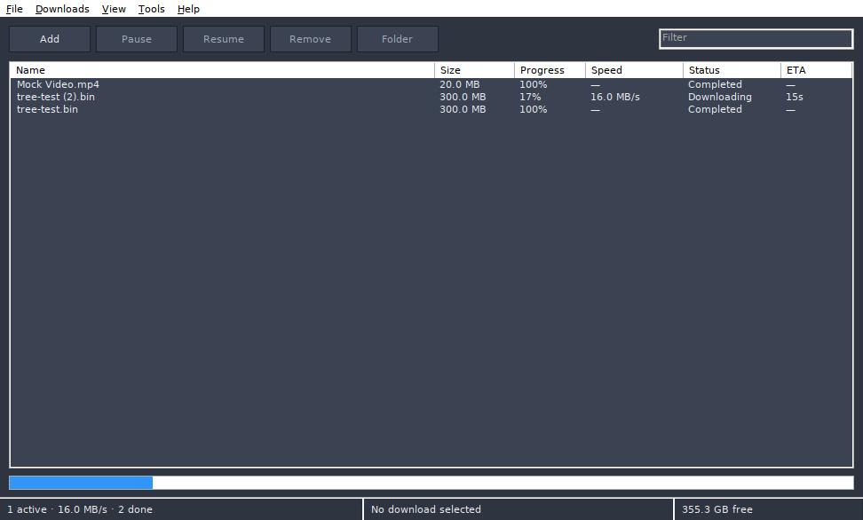

# Tree Downloader — browser extension

Hands links and downloads to **[Tree](https://github.com/fevnem/tree)**, the
native Windows download manager, instead of the browser's own downloader.



*Context menu → "Download this link with Tree"*, or let it take over every
download in the browser.

The extension talks to Tree over a loopback-only endpoint
(`http://127.0.0.1:17817`). Nothing leaves your machine, there is no account, no
telemetry and no remote server.

## Install

Tree 0.4.0 or newer must be running (it opens the endpoint on startup).

**Chrome / Edge / Brave**

1. Download or clone this folder.
2. `chrome://extensions` → enable **Developer mode** → **Load unpacked** →
   select this folder.
3. Pin the icon. The popup shows whether Tree is reachable.

**Firefox**

1. Rename `manifest.firefox.json` to `manifest.json` (keep a copy of the
   Chromium manifest).
2. `about:debugging#/runtime/this-firefox` → **Load Temporary Add-on** →
   select `manifest.json`.

## Use

| Action | Result |
|---|---|
| Right-click a link | **Download this link with Tree** |
| Right-click a page or video | **Download this page with Tree** |
| Right-click → **Pick links on this page…** | a picker window listing every link, media file and image on the page |
| Toolbar popup → the big button | sends the current tab |
| Toolbar popup → **Pick links on this page…** | same picker |
| `Alt+Shift+D` | send the current page |
| `Alt+Shift+A` | open the picker |
| Popup → *Take over browser downloads* | every browser download is cancelled and re-queued in Tree |

### The picker

The picker lists what the page actually contains, grouped by **media** (`mp4`,
`mkv`, `mp3`, `m3u8`, `mpd`, …), **images** and plain **links**, de-duplicated and
capped at 2000 entries. Media starts checked; there is a text filter, per-kind
chips and *Select all shown*, then one button sends the selection to Tree in a
single pass. A page with 400 links is a two-click job instead of 400.

The takeover toggle is stored per browser profile and applies to http(s)
downloads only; `blob:` and `data:` URLs stay in the browser because Tree cannot
fetch them.

## How it works

```
browser  --GET /add?url=<encoded>-->  127.0.0.1:17817  -->  Tree engine
browser  --GET /ping------------->    {"ok":true,"app":"tree"}
```

Tree answers with CORS headers so an extension page may call it directly. The
listener binds to `127.0.0.1` only, accepts `GET /add?url=…` and `/ping`, and
ignores everything else. If the port is already taken by another program, Tree
runs normally and only the bridge is unavailable.

## Files

```
manifest.json           Chromium (MV3)
manifest.firefox.json   Firefox (MV2)
background.js           context menus, link collection, takeover, message bridge
popup.html / popup.js   status, send button, picker button, takeover toggle
picker.html / picker.js the bulk link picker window
icons/                  16/32/48/128
scripts/make-icons.py   regenerates the icons
```

## Licence

MIT.
